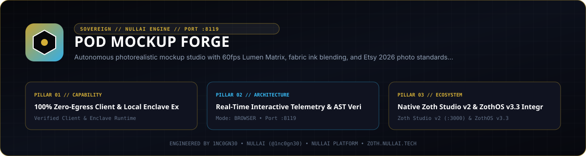

<div align="center">
  
</div>

# POD Mockup Forge

Print-on-Demand mockup scene renderer, printable zone aspect-fit calculator, 10-slot Etsy carousel planner, and Etsy seller photo compliance auditor.

- **Repository**: `https://github.com/1nc0gn30/pod-mockup-forge`
- **Zoth Studio v2 Dossier**: `https://zoth.nullai.tech/tools/pod-mockup-forge`
- **Local Workstation**: `http://127.0.0.1:8119`
- **Version**: `2.5.0`
- **Author**: 1nc0gn30 (`@1nc0gn30`, `https://1nc0gn30.si`) • NullAI (`https://nullai.tech`)
- **License**: MIT (100% free and open-source; zero paywalls)

---

## Overview

POD Mockup Forge generates SVG and HTML5 Canvas product mockups across apparel, drinkware, wall art, and accessory templates while auditing output dimensions, aspect ratios, and file sizes against Etsy photo requirements. The Python HTTP server, CLI, binary image header prober, and stdio MCP server run entirely on the Python 3.10+ standard library.

### Core Modules

- **Template Library (`templates.py`)**: Structured product definitions (`gildan_18000_flatlay`, `comfort_colors_1717_hanger`, ceramic mugs, canvas wall art, tote bags) with canvas dimensions, printable zone bounding coordinates, blend modes, and garment color swatches.
- **Composite Engine (`composite_engine.py`)**: Computes aspect-fit scaling and offset coordinates, generates layered SVG mockup scenes, and optionally applies diagonal anti-scraper watermark overlays.
- **Binary Image Header Probe (`image_probe.py`)**: Reads pixel width, pixel height, and file size directly from PNG, JPEG, GIF, and WebP files without external imaging libraries.
- **Etsy 2026 Photo Compliance Auditor (`etsy_specs.py`)**: Evaluates minimum long-edge resolution (`>=2000 px`), thumbnail aspect ratio (`4:3` / `5:4` / `1:1`), and file size caps (`<=20 MB`), plus generates a 10-slot Etsy listing photo carousel plan.

---

## Architecture

```
pod-mockup-forge/
├── server.py                              # Daemon entrypoint binding 127.0.0.1:8119
├── bin/
│   ├── pod-mockup-forge                   # CLI entrypoint wrapper
│   └── pod-mockup-forge-tui               # ZothOS v3.4.0 Unicode U+2800 Braille TUI
├── src/pod_mockup_forge/
│   ├── templates.py                       # Apparel, drinkware, wall art & accessory templates
│   ├── composite_engine.py                # Aspect-fit bounding math & SVG scene synthesizer
│   ├── image_probe.py                     # Pure-stdlib PNG/JPEG/GIF/WebP dimension reader
│   ├── etsy_specs.py                      # Etsy photo compliance auditor & 10-slot pack planner
│   ├── server.py                          # Threaded HTTP server with Origin CSRF guard
│   ├── mcp_server.py                      # JSON-RPC 2.0 stdio MCP server (6 tools)
│   └── cli.py                             # Command-line interface
├── public/                                # Browser Canvas compositor & audit workstation
└── tests/                                 # Unit, hardening, bind-host & CSRF origin tests
```

### REST API Endpoints (`http://127.0.0.1:8119`)

| Method | Path | Description |
| :--- | :--- | :--- |
| `GET` | `/health` | Service health status, version (`2.5.0`), port, and uptime |
| `GET` | `/api/stats` | Session telemetry counters (`mockups_rendered`, `photo_audits_performed`, `packs_planned`) |
| `GET` | `/api/templates` | List all mockup templates, print zone coordinates, and color palettes |
| `GET` | `/api/carousel_plan` | Return the 10-slot Etsy listing photo carousel plan |
| `POST` | `/api/render` | Render SVG/JSON mockup scene spec (`template_id`, `artwork_url`, `color_hex`, `watermark`) |
| `POST` | `/api/audit` | Audit image compliance (`width_px`, `height_px`, `file_size_mb`) |

---

## Quickstart

```bash
git clone https://github.com/1nc0gn30/pod-mockup-forge.git
cd pod-mockup-forge

# Optional editable install for the console script
pip install -e .

# Start the local HTTP server on 127.0.0.1:8119
python3 server.py --port 8119
```

Verify the server from another terminal:

```bash
curl -s http://127.0.0.1:8119/health
curl -s http://127.0.0.1:8119/api/templates
```

---

## CLI & MCP Usage

### CLI Commands (`pod-mockup-forge` / `./bin/pod-mockup-forge`)

```bash
# Inspect CLI options, version, and JSON status
./bin/pod-mockup-forge --help
./bin/pod-mockup-forge --version
./bin/pod-mockup-forge --status
./bin/pod-mockup-forge --json

# List available templates (optionally filtered by category)
./bin/pod-mockup-forge list --category apparel --json

# Render a mockup SVG scene specification
./bin/pod-mockup-forge render --template gildan_18000_flatlay --color "#F5F5DC" --json
./bin/pod-mockup-forge render --template gildan_18000_flatlay --output-svg /tmp/mockup.svg

# Calculate aspect-fit placement inside a target print zone
./bin/pod-mockup-forge fit --aw 4500 --ah 5400 --tw 800 --th 1000 --json

# Generate 10-slot Etsy carousel plan
./bin/pod-mockup-forge pack --json

# Audit image dimensions or probe an image file directly
./bin/pod-mockup-forge audit --width 2700 --height 2025 --mb 3.2 --json
./bin/pod-mockup-forge audit --file banner.png --json

# Launch HTTP server or MCP stdio server
./bin/pod-mockup-forge server --port 8119
./bin/pod-mockup-forge mcp
```

### ZothOS v3.4.0 Braille TUI Integration

On ZothOS v3.4.0, `pod-mockup-forge` and `pod-mockup-forge-tui` are installed in `/usr/local/bin` and paired with Zoth Studio v2 (`https://zoth.nullai.tech/tools/pod-mockup-forge`):

```bash
./bin/pod-mockup-forge-tui --help
./bin/pod-mockup-forge-tui --json
```

### MCP Server (`pod-mockup-forge mcp`)

Start the stdio JSON-RPC 2.0 MCP server via `./bin/pod-mockup-forge mcp` or `PYTHONPATH=src python3 -m pod_mockup_forge.mcp_server`.

Exposed MCP tools:
1. `mockup_list_templates` — List mockup templates with optional category filter (`apparel`, `drinkware`, `wall_art`, `accessories`).
2. `mockup_generate_scene` — Generate SVG/JSON mockup scene spec (`template_id`, `artwork_url`, `color_hex`, `watermark`).
3. `mockup_calculate_aspect_fit` — Compute print-area aspect-fit dimensions, offsets, and scale factor.
4. `mockup_batch_generate_listing_pack` — Generate a 10-slot Etsy carousel listing plan.
5. `mockup_audit_etsy_compliance` — Audit pixel dimensions and file size against Etsy photo standards.
6. `mockup_add_watermark_protection` — Generate an SVG diagonal watermark overlay grid.

---

## Testing & Verification

```bash
python3 -m pytest -q
```

Test suites cover:
- `tests/test_mockup_forge.py` — Template schemas, aspect-fit bounding boxes, SVG scene generation, 10-slot carousel planning, and Etsy compliance scoring.
- `tests/test_hardening.py` — Input validation, SVG escaping, and binary image header probing (`PNG`/`JPEG`/`GIF`/`WebP`).
- `tests/test_bind_host.py` — Default `127.0.0.1` loopback binding and `ZOTH_BIND_HOST` IP parsing.
- `tests/test_origin_guard.py` — CSRF `Origin` header validation on mutating POST routes.

---

## Support

This project is 100% free and open-source with zero paywalls or feature gates. Optional support: [Buy Us a Coffee (Stripe)](https://buy.stripe.com/3cIfZg27PdKo2D64Ocfw40X).

## License

MIT License — Engineered by **1nc0gn30** (`@1nc0gn30`, `https://1nc0gn30.si`) • **NullAI** (`https://nullai.tech`).
