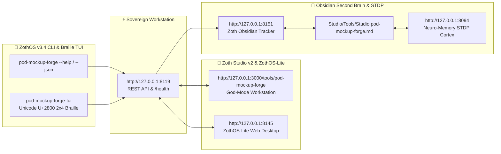

<div align="center">
  
</div>

<br />

<div align="center">
  <a href="https://zoth.nullai.tech/tools/pod-mockup-forge"></a>
  <a href="http://127.0.0.1:8119"></a>
  <a href="https://nullai.tech"></a>
  <a href="https://buy.stripe.com/3cIfZg27PdKo2D64Ocfw40X"></a>
</div>

# ⚡ POD Mockup Forge (v2.5.0)

> **Autonomous photorealistic mockup studio with 60fps Lumen Matrix, fabric ink blending, and Etsy 2026 photo standards compliance auditor.**

---

## 🏛️ Architectural Overview

**POD Mockup Forge** is a sovereign visual commerce powerhouse in the **[Zoth Studio v2](https://zoth.nullai.tech)** arsenal and **[ZothOS Linux 3.3](https://zothos.nullai.tech)** ecosystem, engineered by **1nc0gn30 • NullAI ([@1nc0gn30](https://github.com/1nc0gn30))**.

| Property | Specification |
| :--- | :--- |
| **Tool ID** | `pod-mockup-forge` |
| **Category** | `Commerce & MCP` |
| **Local Port** | `http://127.0.0.1:8119` |
| **Execution Mode** | Native Python Daemon & Browser Client |
| **Zoth Studio Route** | `http://127.0.0.1:3000/tools/pod-mockup-forge` |
| **License** | 100% Free & Open Access (Zero Paywalls) |

---

## 💎 What It Does & How It Works

- **Photorealistic Apparel & Merchandise Scenes**: Generates high-fidelity mockups for top Print-on-Demand products:
  - `gildan_18000_flatlay`: Heavy blend sweatshirt on rustic dark oak wood.
  - `comfort_colors_1717_hanger`: Garment-dyed tee on minimalist brass hanger with sunlit stucco wall.
  - `bella_canvas_3001_model`: Unisex jersey tee in urban natural daylight.
  - `ceramic_mug_15oz_kitchen`: Gloss ceramic mug on Carrara marble counter with French press.
  - `canvas_gallery_wrap_livingroom`: Stretched canvas in Scandinavian minimalist interior.
  - `matte_poster_wood_frame`: Museum-grade archival poster in solid natural oak frame.
  - `canvas_tote_farmers_market`: Heavyweight market tote with fresh florals.
  - `phone_case_flatlay`: Impact dual-layer phone case in executive obsidian EDC flat lay.
- **Fabric Ink Blending & Dynamic Lumen Matrix**: Composites designs using accurate substrate blend modes (multiply, overlay, realistic fiber weave displacement) and lighting highlights.
- **Etsy 2026 Photo Standards Auditor**: Evaluates image resolutions (minimum 2000px shortest side), aspect ratios (1:1 square, 4:3 landscape), sRGB color profile compliance, and under-20MB size limits.
- **10-Slot Carousel Listing Architect**: Plans structured 10-slide visual presentations for optimal conversion (Hero Flat Lay, Lifestyle In-Use, Scale Comparison, Color Swatch Grid, Detail Close-Up, Size Chart).

---

## 🚀 Quick Start

```bash
# Clone and launch the standalone daemon on port 8119
git clone https://github.com/1nc0gn30/pod-mockup-forge.git
cd pod-mockup-forge
python3 server.py --port 8119

# Query daemon health and templates:
curl -s http://127.0.0.1:8119/health
curl -s http://127.0.0.1:8119/api/templates
```

---

## 💻 ZothOS CLI & MCP Commands

The sovereign binary `pod-mockup-forge` is pre-installed in `/usr/local/bin` and `~/.local/bin`:

```bash
# Verify installation & status
pod-mockup-forge --version
pod-mockup-forge --status
pod-mockup-forge --json

# List available templates
pod-mockup-forge list
pod-mockup-forge list --category apparel --json

# Audit image against Etsy 2026 seller photo standards
pod-mockup-forge audit --width 2000 --height 2000 --mb 2.5
pod-mockup-forge audit --file path/to/mockup.png

# Generate mockup scene render spec
pod-mockup-forge render --template gildan_18000_flatlay --artwork "https://example.com/art.png" --color "#F5F5DC"

# Plan 10-slot carousel listing pack
pod-mockup-forge pack --json

# Launch server daemon
pod-mockup-forge server --port 8119
```

---

## ☕ 100% Free & Open-Access Support Architecture

Every tool engineered by 1nc0gn30 • NullAI is **100% free, open, and unlocked by default**. There are zero paywalls, zero license locks, and zero feature gates.

If this tool empowers your business or automates your product photography, consider supporting development:

- **☕ Buy Us a Coffee (Stripe)**: [https://buy.stripe.com/3cIfZg27PdKo2D64Ocfw40X](https://buy.stripe.com/3cIfZg27PdKo2D64Ocfw40X)
- **◎ Solana Tip Address**: `GG2eQbVh8ut1BK6j1A2tz7pSySdLpD38BgyEhGcxdXoK`

---

<div align="center">
  <sub>Engineered by <b>1nc0gn30 • NullAI</b> (<a href="https://github.com/1nc0gn30">@1nc0gn30</a>) &bull; <a href="https://nullai.tech">NullAI Platform</a> &bull; <a href="https://zoth.nullai.tech">Zoth Studio v2</a></sub>
</div>

---

## 🏛️ ZothOS v3.4, Zoth Studio v2 & Obsidian Second Brain Ecosystem



### Cross-Surface Integration Matrix

| Surface | Endpoint / Binary | Capabilities |
| :--- | :--- | :--- |
| **Standalone Workstation** | `http://127.0.0.1:8119` | 100% Free & Open-Access Web Deck, live `/health` & REST telemetry |
| **Zoth Studio v2 Route** | `http://127.0.0.1:3000/tools/pod-mockup-forge` | Interactive God-Mode component inside Zoth Studio (`https://zoth.nullai.tech`) |
| **ZothOS v3.4 CLI & TUI** | `pod-mockup-forge` / `pod-mockup-forge-tui` | Global binary in `/usr/local/bin/` with Unicode `U+2800` Braille TUI & `--json` output |
| **ZothOS-Lite Web Desktop** | `http://127.0.0.1:8145` | Browser-native KDE-style window manager & terminal launcher |
| **Zoth Obsidian Tracker** | `http://127.0.0.1:8151` | Interactive Obsidian Second Brain vault explorer (`~/Documents/Obsidian Vault/Studio/Tools/Studio pod-mockup-forge.md`) |
| **Neuro-Memory STDP Cortex** | `http://127.0.0.1:8094` | 3-Factor STDP synaptic memory daemon & 21-tool MCP server |

```bash
# Inspect CLI & Unicode U+2800 Braille TUI on ZothOS v3.4
pod-mockup-forge --help
pod-mockup-forge-tui --status
pod-mockup-forge-tui --json

# Verify Second Brain Vault & 12-Step Verification Gallery on :8151
zoth-obsidian-tracker --verify
```

